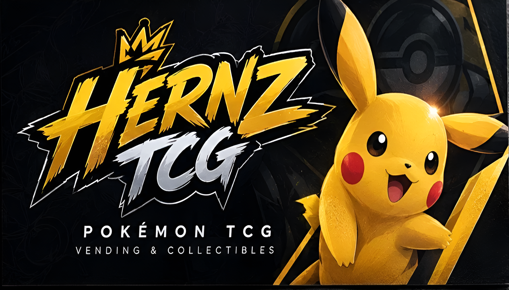

<p align="center">
  
</p>

<h1 align="center">TCG Shopify Example</h1>

<p align="center">
  An example storefront built for <b>HERNZ TCG</b>, a veteran-owned trading card shop.<br>
  It shows what the shop's eBay store could look like as a branded, Shopify-style site, with featured cards, live search and filters, category tiles, and shop-by-set navigation.
</p>

<p align="center">
  
  
  
  
  
</p>

<p align="center">
  🌐 <a href="https://chrisraiz.github.io/TCG-Shopify-Example/"><b>View the Example</b></a>: hosted on GitHub Pages.
</p>

---

> [!IMPORTANT]
> **This is an example site, not HERNZ TCG's live store or a finished product.**
> It was built as a concept to show the shop's owner what a custom storefront could look like. There is no cart or checkout, and the products in `page.js` are a sample snapshot of the store's inventory. Product, category, and set links point to the HERNZ TCG eBay store, so some listings may have since sold or ended.
> It is not representative of HERNZ TCG, and no rights to their company, websites, or assets are owned or claimed. See the [Disclaimer](#disclaimer).

---

## Overview

Marketplace storefronts like eBay's give a seller very little control over how their shop looks. This example shows what the same inventory could look like as a Shopify-style storefront: a bold, branded landing page that keeps buyers browsing, while eBay continues to handle payments, shipping, and buyer protection.

The whole example is a single static page with no framework, no build step, and no dependencies. It is written in plain HTML, CSS, and JavaScript and served directly from GitHub Pages.

---

## Features

### Storefront
- **Hero carousel** that auto-advances every 6.5 seconds, pauses on hover, and supports dot navigation
- **Scrolling ticker** of the games and categories the shop carries
- **Featured products** with high-value graded slabs and chase cards
- **Category tiles** for Pokémon, Yu-Gi-Oh!, One Piece, graded cards, Japanese, vintage, and 99¢ cards
- **Bundle & save** cards that explain the multi-card discounts applied at eBay checkout
- **Shop by set**, with Pokémon sets grouped by era (Scarlet & Violet, Sword & Shield, Sun & Moon and older, Vintage, Japanese, and Specials)
- **About, trust, and FAQ sections**, plus a "Follow on eBay" call to action

### Shopping
- **Live search** that filters cards as you type
- **Filter chips** for Pokémon, Yu-Gi-Oh!, graded, vintage, and cards under $5
- **Sorting** by featured, price low to high, and price high to low
- **Sale and stock badges**, with the original price struck through on discounted cards
- **Graded slab styling** that shows the grade (PSA 10, CGC 10, and so on) on the card art
- When a search has no matches, a link searches the **full eBay store** for the same term

### Visual Effects
- **Holographic tilt** on card art that follows the pointer
- **Drifting spark particles** drawn on `<canvas>`, which only animate while they are on screen
- **Layered neon artwork** built from stacked smoke, lightning, and glint images
- **Scroll reveal** animations and a count-up statistic, driven by `IntersectionObserver`

### Performance & Accessibility
- **Respects `prefers-reduced-motion`**: animations, the carousel, and particles are turned off for users who request it
- Self-hosted **Archivo** and **Inter** fonts with `font-display: swap`
- **WebP** images with lazy loading and fixed dimensions to prevent layout shift
- Responsive layout with a mobile menu drawer and safe-area padding for notched phones
- ARIA labels on the carousel, menu, and navigation, and screen-reader text for image-only tiles

---

## Tech Stack

| Layer     | Technology                                                          |
|-----------|---------------------------------------------------------------------|
| Markup    | HTML5                                                               |
| Styling   | CSS3 (custom properties, grid, masks, blend modes, media queries)   |
| Scripting | Vanilla JavaScript (`IntersectionObserver`, Canvas 2D API)          |
| Fonts     | Archivo and Inter, self-hosted as WOFF2                             |
| Images    | WebP                                                                |
| Hosting   | GitHub Pages                                                        |

---

## Project Structure

```
.
├── index.html     # Page markup: header, hero, featured, categories, bundles, shop, sets, about, FAQ, footer
├── page.css       # All styles, theme tokens, and responsive breakpoints
├── page.js        # Product and set data, search, filters, sorting, carousel, and visual effects
├── motion.js      # Runs before first paint to turn on animations only when supported and allowed
└── assets/
    ├── hernz-logo.webp, hernz-banner.png
    ├── hero-*.webp    # Hero artwork layers (base, smoke, bolts)
    ├── cat-*.webp     # Category tile artwork and titles
    ├── band-*.webp    # Bundle section background layers
    ├── divider-glow.webp, crown.svg
    └── *.woff2        # Archivo and Inter font files
```

---

## Running It Locally

There's nothing to install or build. Clone the repo and serve the folder with any static file server:

```bash
git clone https://github.com/ChrisRaiz/TCG-Shopify-Example.git
cd TCG-Shopify-Example
python3 -m http.server 8000
```

Then open [http://localhost:8000](http://localhost:8000). Opening `index.html` directly in a browser also works.

---

## Updating Products

Products are defined as arrays at the top of `page.js`. `FEATURED` holds the featured row, and `ITEMS` holds the main shop grid:

```js
// [title, price, wasPrice, itemId, game, tag, cardLabel, colorA, colorB, grade]
["Lugia V 186/195 Silver Tempest PSA 9", 499.99, null, "377525527921", "pokemon", "graded", "Lugia V", "#cfd9ff", "#2b3a8f", "PSA 9"]
```

| Field        | Purpose                                                        |
|--------------|----------------------------------------------------------------|
| `title`      | Listing title, also used for search                            |
| `price`      | Current price in USD                                           |
| `wasPrice`   | Original price, which shows a Sale badge (`null` for none)     |
| `itemId`     | eBay item ID the card links to                                 |
| `game`       | `pokemon`, `yugioh`, or `onepiece`                             |
| `tag`        | `graded`, `vintage`, or empty, used by the filter chips        |
| `cardLabel`  | Name shown on the card art                                     |
| `colorA/B`   | Gradient colors for the card art                               |
| `grade`      | Optional slab grade, such as `PSA 10`                          |

Sets are listed in `GROUPS`, each paired with its eBay store category ID.

---

## Disclaimer

This example is not representative of HERNZ TCG and is not an official HERNZ TCG website. I do not own or claim any rights to HERNZ TCG, its company, websites, store listings, name, logo, branding, or other assets, which belong to their respective owners.

Pokémon, Yu-Gi-Oh!, One Piece, and all related names are trademarks of their respective owners. This project is not affiliated with or endorsed by Shopify, eBay, The Pokémon Company, Konami, or Bandai.
